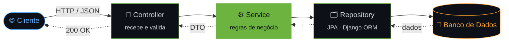

<!--
  200 OK — você abriu o código-fonte do README.
  Curiosidade de quem lê o código por trás da tela. Gostei de você.
-->

<div align="center">


### `Pedro Linard API` · `v1.0.0`

**Back-end Developer em formação** · Análise e Desenvolvimento de Sistemas

`Java` · `Spring Boot` · `Python` · `Django` · `REST` · `Redes`

</div>

> [!NOTE]
> **Este perfil é uma API.** Em vez de te contar quem eu sou, deixo você *consultar*.
> Escolha um endpoint abaixo — todas as respostas são reais.

---

### `$ curl -X GET https://api.pedrolinard.dev/v1/pedro`

```http
HTTP/1.1 200 OK
Content-Type: application/json
Accept-Language: pt-BR, en;q=0.6
X-Status: em-evolucao-constante
```

```json
{
  "nome": "Pedro Linard",
  "formacao": "Análise e Desenvolvimento de Sistemas",
  "foco": "Desenvolvimento back-end",
  "missao": "Construir soluções escaláveis, organizadas e alinhadas às boas práticas de engenharia de software",
  "stack": {
    "java":   ["Spring Boot", "JPA", "POO", "Arquitetura em camadas"],
    "python": ["Django", "Modelagem de dados", "Sistemas web estruturados"]
  },
  "experiencia": ["APIs REST", "Regras de negócio", "Integração com banco de dados", "Git"],
  "diferencial": "Redes de computadores — entendo o caminho que a requisição faz antes de chegar no meu código",
  "idiomas": { "portugues": "nativo", "ingles": "B1 — leio documentação técnica sem dificuldade" },
  "disponivel_para": ["estágio", "projetos", "colaborações"]
}
```

---

### 📑 `Endpoints disponíveis`

| Método | Endpoint | Descrição |
|:---:|:---|:---|
|  | [`/sobre`](#-get-sobre) | Quem eu sou e como penso software |
|  | [`/arquitetura`](#-get-arquitetura) | Como eu estruturo uma aplicação |
|  | [`/rede`](#-get-rede) | O que acontece antes do back-end |
|  | [`/stack`](#-get-stack) | Tecnologias e ferramentas |
|  | [`/roadmap`](#-put-roadmap) | O que estou atualizando em mim |
|  | [`/contato`](#-post-contato) | Fale comigo |

---

### 🔵 `GET /sobre`

Estudante de **Análise e Desenvolvimento de Sistemas** com foco em **back-end** — a parte do software que ninguém vê, mas que todo mundo sente quando falha.

- 💡 Desenvolvo projetos acadêmicos e pessoais com **Java (Spring Boot)** e **Python (Django)**, construindo **APIs REST**, implementando regras de negócio e integrando com banco de dados.
- 🔧 Com **Spring Boot**, aprofundo **POO**, **arquitetura em camadas** e **persistência com JPA**.
- 🐍 Com **Django**, construo **sistemas web estruturados**, modelo dados e implemento funcionalidades de back-end.
- 🌐 Tenho base em **redes de computadores**, o que muda a forma como enxergo comunicação entre sistemas e aplicações distribuídas.

```diff
- Código que só funciona.
+ Código que funciona, escala e outra pessoa consegue manter.
```

---

### 🔵 `GET /arquitetura`

> Como uma requisição atravessa uma aplicação que eu construo — cada camada com **uma** responsabilidade.



---

### 🔵 `GET /rede`

> A maioria dos devs começa a pensar quando a requisição chega no controller. Eu começo antes.

```bash
$ traceroute pedro-linard
 1  estudante-ads          0.1 ms   # fundamentos, lógica, POO
 2  redes-de-computadores  1.2 ms   # TCP/IP, DNS, HTTP — como os sistemas conversam
 3  apis-rest              3.4 ms   # Spring Boot · Django
 4  banco-de-dados         5.1 ms   # modelagem, JPA, ORM
 5  arquitetura            * * *    # em rota...
 6  engenheiro-back-end    * * *    # destino final 🎯
```

---

### 🔵 `GET /stack`

<div align="center">

[](https://skillicons.dev)

</div>

---

### 🟠 `PUT /roadmap`

> Status `102 Processing` — atualizações em andamento.

```
arquitetura de software   [████████░░░░░░░░░░░░]  em estudo
modelagem de banco        [██████████░░░░░░░░░░]  em prática
segurança de APIs         [██████░░░░░░░░░░░░░░]  em estudo
cloud computing           [████░░░░░░░░░░░░░░░░]  próximo deploy
inglês B1 → B2            [██████████░░░░░░░░░░]  em progresso
```

<details>
<summary><b>⚠️ <code>404 — clique para ver o que não foi encontrado</code></b></summary>

<br/>

```http
HTTP/1.1 404 Not Found

{
  "erro": "Recurso 'desistir' não encontrado neste servidor.",
  "sugestao": "Tente GET /evoluir"
}
```

</details>

---

### 🟢 `POST /contato`

```bash
curl -X POST https://api.pedrolinard.dev/v1/contato \
  -H "Content-Type: application/json" \
  -d '{ "assunto": "vamos construir algo juntos?" }'
```

| Canal | Endpoint |
|:---|:---|
| 💼 LinkedIn | [linkedin.com/in/pedrolinard](https://www.linkedin.com/in/pedrolinard/) |
| 📧 Email | [pedrolin4rd@gmail.com](mailto:pedrolin4rd@gmail.com) |
| 📸 Instagram | [@pedr.py](https://www.instagram.com/pedr.py/) |

<div align="center">

<br/>

```http
HTTP/1.1 201 Created
Location: /conexoes/voce
```

<sub>⚙️ Servidor no ar · tempo de resposta: rápido · uptime: aprendendo todos os dias</sub>

</div>
