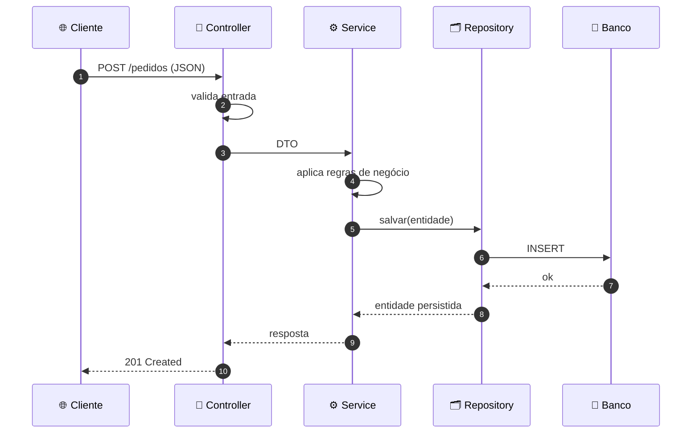

<!-- 200 OK — se você abriu o código-fonte, já temos algo em comum. -->

<div align="center">


<br/>

<a href="https://www.linkedin.com/in/pedrolinard/"></a>
<a href="mailto:pedrolin4rd@gmail.com"></a>
<a href="https://www.instagram.com/pedr.py/"></a>


</div>

<br/>

<table>
<tr>
<td width="58%" valign="top">

### 👨‍💻 Sobre mim

Estudante de **Análise e Desenvolvimento de Sistemas**, focado em **back-end** — a camada que ninguém vê, mas que todo mundo sente quando falha.

- 💡 Construo **APIs REST**, regras de negócio e integrações com banco de dados usando **Java (Spring Boot)** e **Python (Django)**
- 🔧 No **Spring Boot**, aprofundo **POO**, **arquitetura em camadas** e **persistência com JPA**
- 🐍 No **Django**, construo **sistemas web estruturados** e modelagem de dados
- 🌐 Base em **redes de computadores** — entendo o caminho da requisição *antes* dela chegar no meu código
- 🗣️ Inglês **B1** — documentação técnica sem dificuldade

</td>
<td width="42%" valign="top">

### `pedro.json`

```json
{
  "foco": "back-end",
  "stack": [
    "Java · Spring Boot",
    "Python · Django"
  ],
  "domino": [
    "APIs REST",
    "JPA / ORM",
    "Arquitetura em camadas"
  ],
  "diferencial": "redes",
  "status": "evoluindo"
}
```

</td>
</tr>
</table>

---

### ⚡ Como eu penso uma requisição

> Cada camada com uma única responsabilidade. Simples de ler, fácil de testar, pronto pra escalar.



---

### 🛠️ Stack

<div align="center">


</div>

---

### 🚀 Em evolução

<div align="center">

| Área | Status |
|:---|:---:|
| Arquitetura de Software |  |
| Modelagem de Banco de Dados |  |
| Segurança de APIs |  |
| Cloud Computing |  |
| Inglês B1 → B2 |  |

</div>

---

### 📊 Em números

<div align="center">


</div>

---

<details>
<summary><b>🔍 Easter egg — <code>GET /desistir</code></b></summary>

<br/>

```http
HTTP/1.1 404 Not Found

{ "erro": "Recurso não encontrado neste servidor.", "sugestao": "GET /evoluir" }
```

</details>


